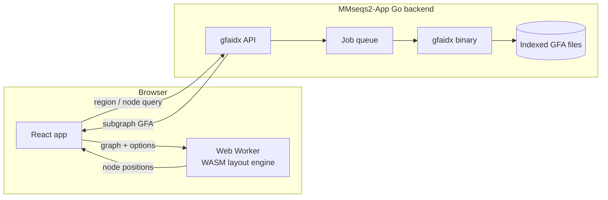

# Development

Technical notes for running, building, and hosting gfaidx-viz. For what the
app does, see the [README](README.md).

- [Repository layout](#repository-layout)
- [How the pieces fit together](#how-the-pieces-fit-together)
- [Running the frontend locally](#running-the-frontend-locally)
- [Running your own gfaidx backend](#running-your-own-gfaidx-backend)
- [Demonstrating on a local network](#demonstrating-on-a-local-network)
- [Building the WASM layout engine](#building-the-wasm-layout-engine)
- [Layout engine JavaScript API](#layout-engine-javascript-api)
- [Deployment](#deployment)
- [Legacy Python backend](#legacy-python-backend)

## Repository layout

```
├── frontend/                 # React + Vite web app (what users see)
├── src/, include/            # C++ sources for the WASM layout engine
├── layout_wasm/              # Build script and OGDF source for the engine
├── js/                       # Pre-built engine (WASM + JS wrappers), committed
├── examples/                 # Standalone usage examples for the engine
├── legacy_fastapi_backend/   # Older Python backend, kept for reference
└── run_dev.sh                # Dev launcher for the legacy backend + frontend
```

## How the pieces fit together



The heavy lifting is split in two:

- **Subgraph extraction** happens on the server. The
  [MMseqs2-App](https://github.com/soedinglab/MMseqs2-App) Go backend runs
  [gfaidx](https://github.com/fawaz-dabbaghieh/gfaidx) against pre-indexed
  graphs and returns a small GFA.
- **Layout and drawing** happen in the browser. The Bandage/OGDF layout engine
  is compiled to WebAssembly and runs in a Web Worker, and the result is drawn
  on a canvas.

Graphs opened from a local file or URL skip the server entirely.

## Running the frontend locally

The pre-built layout engine is committed in `js/`, so the frontend only needs
Node.js 20 or newer:

```bash
cd frontend
npm install
npm run dev
```

Open `http://localhost:5173`. `npm run dev` and `npm run build` first copy the
engine files from `js/` into `frontend/public/js/`.

By default the app talks to the public backend at
`https://search.foldseek.com`. To point it somewhere else:

```bash
VITE_BACKEND_URL=http://127.0.0.1:18081 \
  VITE_PREFER_BACKEND_URL=true \
  npm run dev
```

- `VITE_BACKEND_URL` replaces the default backend address.
- `VITE_PREFER_BACKEND_URL=true` makes that address win over one saved in the
  browser.

The backend address field in the app is hidden, but the app still reads a
`backendUrl` value from the browser's local storage. If the app keeps talking
to an old backend, clear that value from the browser console:

```js
localStorage.removeItem('backendUrl')
```

Useful commands from `frontend/`:

```bash
node_modules/.bin/tsc -b        # type-check
npm run build                   # production build into frontend/dist
npm run preview                 # serve the production build
```

## Running your own gfaidx backend

### Backend API

The frontend uses the Go backend's ticket-based job flow:

| Request | Purpose |
|---|---|
| `GET /api/gfaidx/graphs` | List the indexed graphs the server offers |
| `GET /api/gfaidx/graphs/{graph_id}/region-paths` | List the paths/walks that can be queried by coordinate |
| `POST /api/ticket/gfaidx/region` | Submit a coordinate-region query |
| `POST /api/ticket/gfaidx/subgraph` | Submit a node-neighborhood query |
| `GET /api/ticket/{ticket}` | Poll until the status is `COMPLETE` or `ERROR` |
| `GET /api/result/gfaidx/{ticket}` | Download the resulting GFA (or the error) |

While a ticket is `PENDING` or `RUNNING`, the frontend waits one second
between status requests. Graphs are registered on the server through
`<graph-id>.params` files, and graph file paths are never accepted from the
browser.

### Starting the Go backend

The gfaidx routes are only registered when the backend runs as
`app: "foldseek"`, because `server.go` gates `RegisterGfaidxApi` on
`config.App == AppFoldseek && config.Gfaidx != nil`. With `-app mmseqs`,
every `/api/gfaidx/*` and `/api/ticket/gfaidx/*` request returns 404.

Running as `foldseek` normally also requires the Foldseek, FoldMason and
FoldDisco binaries, unless `local.delegate` excludes those job types. That
setting is a list, and the backend's command-line flag parser only supports
single values (`-local.delegate ...` panics with `leaf node type not
implemented`). So it has to be set in a JSON config file.

From the MMseqs2-App repository:

```bash
conda activate mmseqs2-app
mkdir -p /private/tmp/mmseqs-gfaidx-api/{databases,jobs,tmp}
```

Save the following as `/private/tmp/mmseqs-gfaidx-api/config.json`, adjusting
the paths for your machine:

```json
{
  "app": "foldseek",
  "server": {
    "address": "127.0.0.1:18081",
    "pathprefix": "/api",
    "cors": true
  },
  "paths": {
    "databases": "/private/tmp/mmseqs-gfaidx-api/databases",
    "results": "/private/tmp/mmseqs-gfaidx-api/jobs",
    "temporary": "/private/tmp/mmseqs-gfaidx-api/tmp"
  },
  "local": {
    "workers": 1,
    "checkold": true,
    "delegate": [
      "search", "index", "msa", "nuclmsa", "pair",
      "structuresearch", "rnasearch", "complexsearch", "interfacesearch",
      "foldmasoneasymsa", "folddisco"
    ]
  },
  "gfaidx": {
    "binary": "/path/to/MMseqs2-App/gfaidx_test/bin/gfaidx",
    "databases": "/path/to/MMseqs2-App/gfaidx_test",
    "timeoutseconds": 120,
    "maxthreads": 2
  }
}
```

`local.delegate` lists every MMseqs/Foldseek job type, so the local process
never needs those binaries. `gfaidx` is left off the list so it keeps running
on this machine.

Then start the backend from the MMseqs2-App repository and check that it sees
your graphs:

```bash
cd backend
go run . -local -config /private/tmp/mmseqs-gfaidx-api/config.json

curl http://127.0.0.1:18081/api/gfaidx/graphs
```

Finally, start the frontend against it as shown in
[Running the frontend locally](#running-the-frontend-locally).

### Checking a job from the command line

This submits a region query the same way the frontend does:

```bash
curl -X POST \
  -H 'Content-Type: application/json' \
  --data '{"graph_id":"chr22","reference":"CHM13","sequence":"chr22","start":1000000,"end":1001000,"max_nodes":20,"all_haplotypes":false}' \
  http://127.0.0.1:18081/api/ticket/gfaidx/region
```

Copy the returned `id`, then poll it and download the result:

```bash
curl http://127.0.0.1:18081/api/ticket/TICKET_ID
curl -o result.gfa http://127.0.0.1:18081/api/result/gfaidx/TICKET_ID
```

The result endpoint returns the GFA only after the ticket is `COMPLETE`.

## Demonstrating on a local network

Another device on the same network can use the app. The simplest setup keeps
the Go backend bound to `127.0.0.1` and exposes only Vite, which forwards
`/api` requests to the backend.

With the Go backend running, start the frontend in network mode from
`frontend/`:

```bash
LAPTOP_LAN_IP="$(ipconfig getifaddr en0)"

VITE_BACKEND_URL="http://${LAPTOP_LAN_IP}:5173" \
  VITE_PREFER_BACKEND_URL=true \
  VITE_BACKEND_PROXY_TARGET=http://127.0.0.1:18081 \
  npm run dev -- --host 0.0.0.0 --port 5173
```

Vite prints a **Network** URL such as `http://192.168.1.25:5173`. Open that URL
on the other device; `localhost` and `0.0.0.0` won't work there.

- If `en0` returns nothing, try `ipconfig getifaddr en1`.
- Both devices must be on the same network, and the laptop's firewall must
  allow incoming connections to Vite.

Alternatively, bind the Go backend itself with
`-server.address 0.0.0.0:18081`, keep `-server.cors true`, and point the
frontend at `http://<laptop-ip>:18081`. This exposes both ports.

These development setups have no authentication, so only use them on a trusted
network and never expose them directly to the internet.

## Building the WASM layout engine

You only need this when changing the C++ code in `src/` or `include/`. The
Conda environment pins a compatible Emscripten:

```bash
conda env create -f environment.yml
conda activate graphviz-wasm
./layout_wasm/build.sh
```

The first build compiles OGDF and takes a while. The output lands in `js/`.
More detail, including using a separately installed Emscripten SDK, is in
[BUILDING.md](BUILDING.md).

The engine is a port of the [Bandage](https://github.com/rrwick/Bandage)
layout code with the Qt dependencies replaced:

- `QPointF` → `Point {double x, y}`
- `QString` → `std::string`
- `QList`/`QVector` → `std::vector`
- `QFile`/`QJson` → custom JSON parser/writer
- `QFuture`/`QtConcurrent` → removed (a Web Worker does this job)

## Layout engine JavaScript API

The engine can also be used on its own, outside the app.

### Usage

```javascript
import { BandageLayout } from './js/bandage-layout-wrapper.js';

const layout = new BandageLayout();
await layout.init();

const result = layout.computeLayout(graphData, {
  quality: 2,
  linearLayout: true,
  referencePathName: 'CHM13#0#chr22',
  componentSeparation: 15.0,
});

console.log(result.nodePositions);
```

To keep the page responsive, the app runs this inside a Web Worker
(`js/bandage-layout.worker.js`).

### Options

| Option | Type | Meaning |
|---|---|---|
| `quality` | 0-4 | Layout effort (more iterations at higher values) |
| `linearLayout` | boolean | Lay the graph out left to right |
| `referencePathName` | string | Path to straighten in linear mode; empty means node-ID order |
| `componentSeparation` | number | Space between disconnected components |
| `aspectRatio` | number | Target width/height ratio |
| `nodeLengthPerMegabase` | number | Drawn length per Mb of sequence |
| `minimumNodeLength` | number | Shortest drawn node |
| `nodeSegmentLength` | number | Length of each drawn node segment |
| `edgeLength` | number | Distance between connected nodes |

Node-ID order only works when every node ID is an integer. Other IDs (such as
rGFA's `s123`) abort the WASM module, so the app requires a reference path for
those graphs.

### Data format

Input:

```javascript
{
  nodes: [
    { id: "1+", length: 5000 },
    { id: "2+", length: 1200 },
  ],
  edges: [
    { from: "1+", to: "2+", overlap: 0 },
  ],
  paths: [
    { name: "CHM13#0#chr22", nodeIds: ["1+", "2+"] },
  ],
}
```

Output, with one list of segment points per node:

```javascript
{
  nodePositions: {
    "1+": [{ x: 0.0, y: 0.0 }, { x: 10.5, y: 0.2 }],
    "2+": [{ x: 12.0, y: 0.5 }, { x: 22.3, y: 1.1 }],
  }
}
```

## Deployment

Pushing to `main` runs `.github/workflows/deploy-pages.yml`, which builds the
frontend and publishes it to GitHub Pages at
<https://fawaz-dabbaghieh.github.io/gfaidx-viz/>. The workflow doesn't set
`VITE_BACKEND_URL`, so the deployed app uses the default backend
(`https://search.foldseek.com`).

## Legacy Python backend

`legacy_fastapi_backend/` is an older FastAPI backend with immediate-response
endpoints. The frontend now targets the Go ticket API described above, so it
is only kept for reference. `run_dev.sh` launched it together with the
frontend, but still expects it at `backend/` (its old location), so it won't
start as-is.
