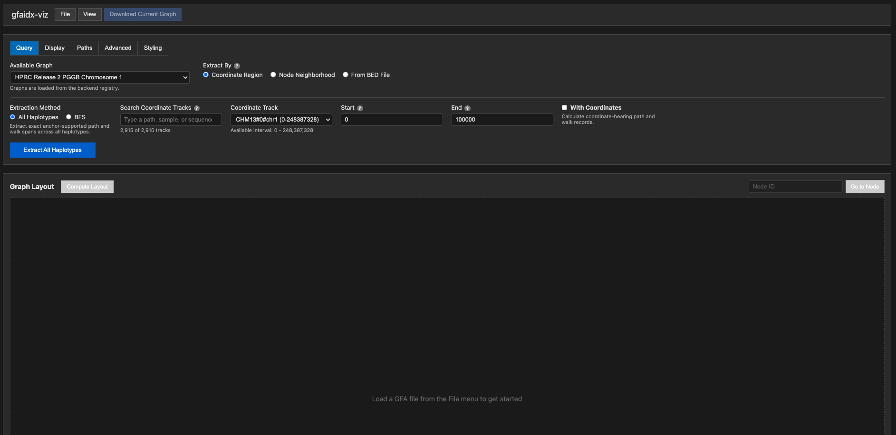
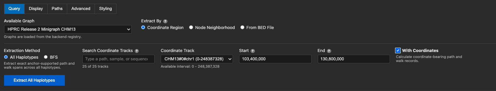
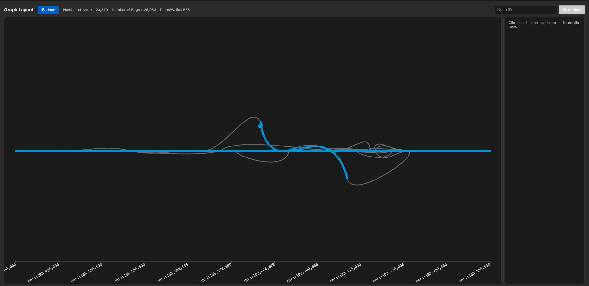
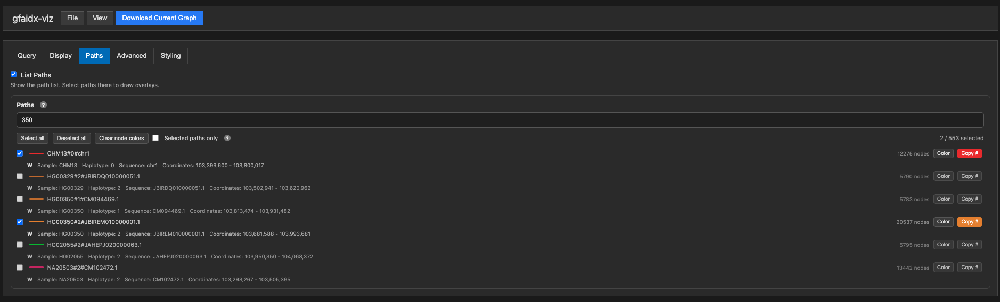
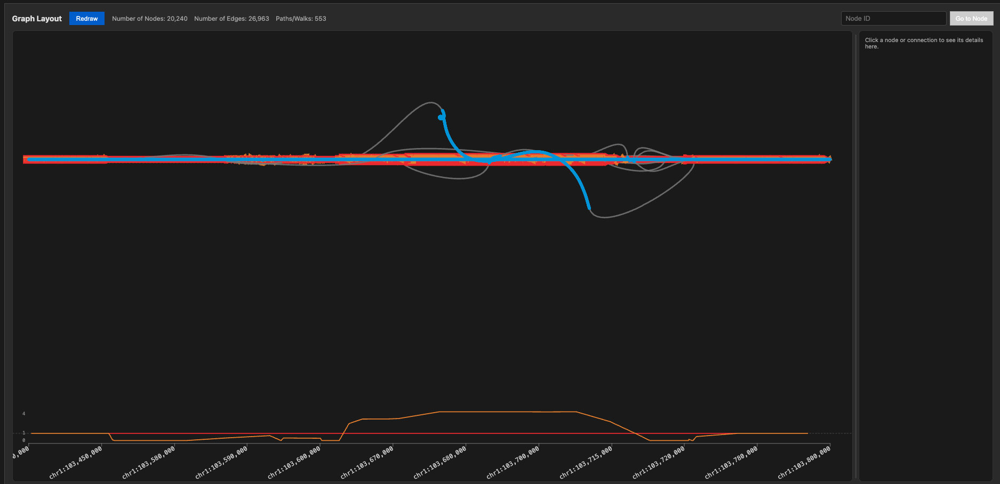
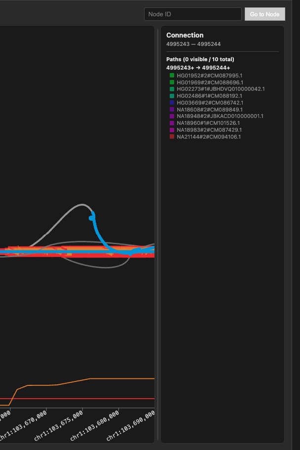
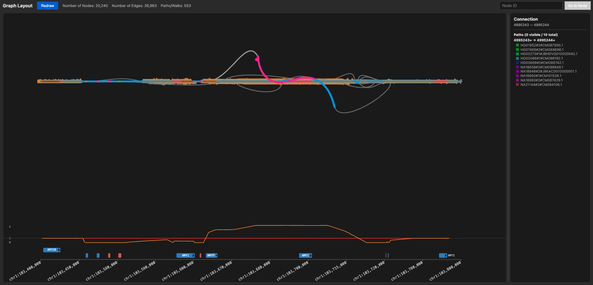
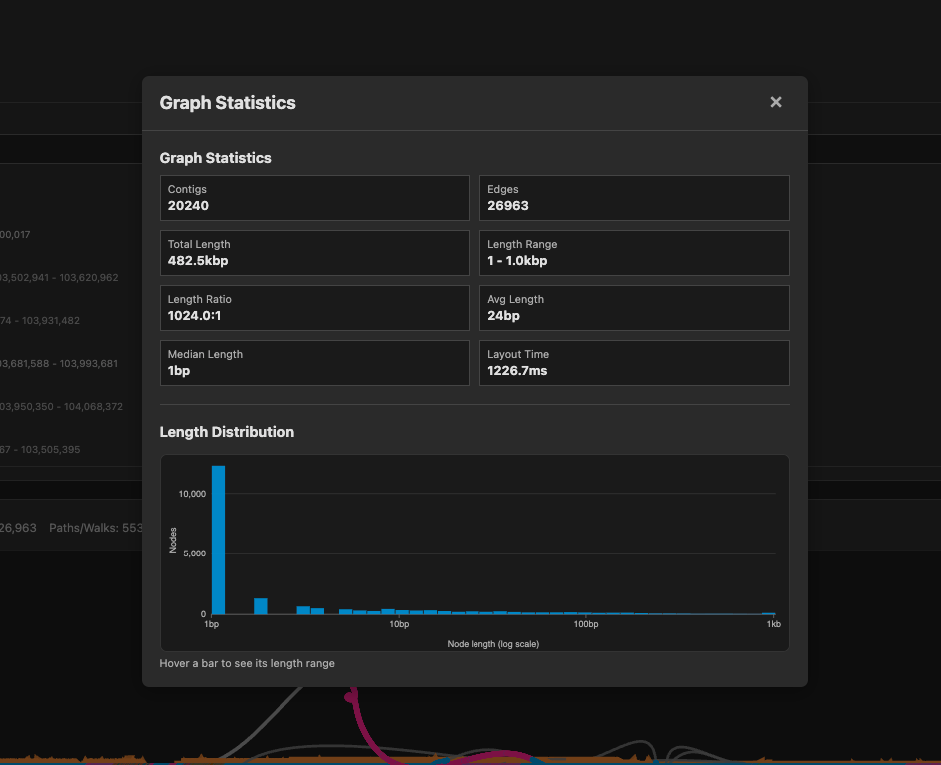

# gfaidx-viz

Explore pangenome and assembly graphs in your browser, even ones far too large
to open in one piece.

**Try it:** <https://fawaz-dabbaghieh.github.io/gfaidx-viz/>



gfaidx-viz pulls a small region out of a huge indexed graph, such as a whole
HPRC pangenome, and lays it out on the spot. The extraction runs on a server
with [gfaidx](https://github.com/fawaz-dabbaghieh/gfaidx); the layout and
drawing run in your browser. You can also open your own GFA files directly.

## Features

### Query a region of a huge graph

Pick one of the indexed graphs hosted on the server, then extract a subgraph:

- **Coordinate region**: a range on a reference path, e.g.
  `CHM13 chr1:1,000,000-1,010,000`. Optionally include all haplotypes that
  pass through it.
- **Find a gene**: type a gene name, e.g. `BRCA1`, to fill in its GRCh38 or
  CHM13 region plus a flank.
- **Node neighborhood**: the nodes around a starting node, up to a size limit.
- **From a BED file**: load a BED/TSV of regions and pick one to fill in the
  coordinates.



### Linear layout along a reference

Straighten a reference path so the graph reads left to right like a genome
browser, with a coordinate ruler underneath. After a region query, the queried
path is used automatically. rGFA graphs (such as minigraph graphs) have no
explicit paths, so the app builds the reference path from the segments'
`SN`/`SO`/`SR` tags.

On a GRCh38 or CHM13 reference, protein-coding genes are drawn above the ruler
automatically, with exons, UTRs and strand. This uses the
[MANE Select](https://www.ncbi.nlm.nih.gov/refseq/MANE/) transcript of each
gene, shipped with the app. On CHM13 it also shows the extra copies of genes
that CHM13 has more of than GRCh38, such as AMY1. It needs reference
coordinates in the graph, which the minigraph and Minigraph-Cactus graphs
provide through their rGFA tags.



### Follow paths through the graph

- List every path or walk in the subgraph and overlay the ones you choose, each
  in its own color.
- Hide everything that isn't on the selected paths.
- Color the nodes of a path.
- Draw a copy-number track showing how often a path visits each part of the
  reference.





### Inspect nodes and connections

Click a node or a connection to see its details in the panel next to the
graph:

- **Node**: length, depth, a sequence preview, its GFA tags, and every path
  that visits it.
- **Connection**: every path that crosses it, in each direction.

When a path loops through the same spot several times, as in repeats, the
count is shown next to its name, e.g. `CHM13#0#chr20 (10×)`. Drag the panel's
edge to widen it for long path names.



### Color and annotate

- **Node styling**: load a CSV/TSV of node colors and labels
  (BandageNG-style).
- **Gene track**: load your own BED file (BED12 adds exons) to replace the
  built-in genes above the coordinate ruler.



### Graph statistics

Node and edge counts, total length, node length summary, and a length
histogram. It switches to a log scale when node lengths span several orders of
magnitude.



### Your own files

Open a GFA from your computer or from a URL, and download the subgraph you're
looking at to use in other tools.

## Navigating the graph

| Action | How |
|---|---|
| Zoom | Scroll |
| Pan | Drag the background |
| Move a node | Drag the node |
| Rotate | Alt + scroll |
| Details | Hover over a node or connection; click to pin the details in the side panel |
| Find a node | Type its ID in **Go to Node** |

Settings are grouped into tabs above the graph:

- **Query**: choose a graph and run a query.
- **Display**: linear layout, colors, labels.
- **Paths**: the path list and overlays.
- **Advanced**: layout fine-tuning.
- **Styling**: CSV and gene-track files.

## Supported input

GFA 1 with segments (`S`), links (`L`), paths (`P`) and walks (`W`). rGFA tags
(`SN`, `SO`, `SR`) are used for linear layout, and depth is read from
`dp`/`RC`/`FC`/`KC` tags when present.

## Running it yourself

The hosted app above needs nothing installed. To run the app locally:

```bash
cd frontend
npm install
npm run dev
```

You need Node.js 20 or newer. See [DEVELOPMENT.md](DEVELOPMENT.md) for:

- running your own gfaidx backend
- demonstrating the app on a local network
- rebuilding the WebAssembly layout engine
- how the pieces fit together

## Background

This project started as a fork of [BandageJS](https://github.com/GMOD/BandageJS),
a WebAssembly port of the layout engine from
[Bandage](https://github.com/rrwick/Bandage). It has since grown into a
pangenome viewer built around indexed graph queries. The layout itself still
comes from Bandage, using [OGDF](https://ogdf.uos.de)'s FMMM algorithm. The
gfaidx queries are served by the
[MMseqs2-App](https://github.com/soedinglab/MMseqs2-App) backend.

## License

GPLv3, the same as Bandage. See [LICENSE](LICENSE).
